<div align="center">
  

# HABITAT AI

**Housing Application Bias, Integrity, Transparency & Accountability Toolkit**

### Fairer Housing. Clearer Decisions.

Help housing intake caseworkers identify applications needing closer human review.<br />
Connect applicant tracking, local model assessment, explainability and accountable review in one workspace.

**Project Lead & lead developer: Advaith Ganesh**<br />
Advaith Ganesh · Abdul Malik · Ishaant Verma<br />
**SotonShip 2026 — Responsible AI Track**

 [](LICENSE)

[Quick Start](#quick-start-for-mac) · [Live Workflow](#live-workflow) · [Model Evidence](#model-evidence) · [Responsible AI](#responsible-ai) · [Meet the Team](#meet-the-team)

</div>

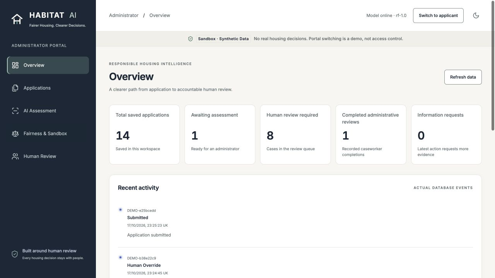

> **Sandbox · Synthetic Data.** A working local demonstration, with openly published generated data. HABITAT AI recommends intake-review routes; it does not approve housing, rank applicant worthiness or determine statutory eligibility.

| Built for | Working capability | Evidence boundary |
|---|---|---|
| Housing intake caseworkers and applicants | Connected submission, assessment, explanation, human review and status tracking | Tested on synthetic cases; no real-world housing validation |
| Responsible AI reviewers | Fairlearn diagnostics, real Tree SHAP, uncertainty routing and saved review reasons | Subgroup disparities and a missed validation target remain visible |
| Technical judges | Saved local Random Forest, reproducible data, inspectable reports and browser tests | No paid inference API required; production security is unfinished |

[Two-minute demo script](docs/DEMO_CHECKLIST.md) · [Judge Q&A](docs/JUDGE_QA.md) · [V7 technical audit](docs/V7_FINAL_REMEDIATION_REPORT.md) · [README showcase verification](docs/FINAL_README_SHOWCASE_REPORT.md)

## Why this project exists

Incomplete evidence and unclear submissions create work for housing intake teams. HABITAT AI brings the structured application, missing-evidence declarations, model reasoning and caseworker response together. Applicants can see the actual saved status rather than an unexplained model score.

The primary user is a **housing intake caseworker**. A **local authority or housing association** is a potential buyer, not an existing customer. This is a university hackathon prototype.

The [Local Government and Social Care Ombudsman’s housing-applications fact sheet](https://www.lgo.org.uk/make-a-complaint/fact-sheets/housing/housing-applications) documents application-handling and delay complaints. Related [English homelessness assessment guidance](https://www.gov.uk/guidance/homelessness-code-of-guidance-for-local-authorities/chapter-11-assessments-and-personalised-plans) motivates individual assessment and review when circumstances change. Homelessness assistance and housing allocation are distinct processes. These sources establish context, not this model’s validity or measured service improvements.

## Live workflow

A connected journey in the local application; “live” describes the working workflow, not a public deployment.

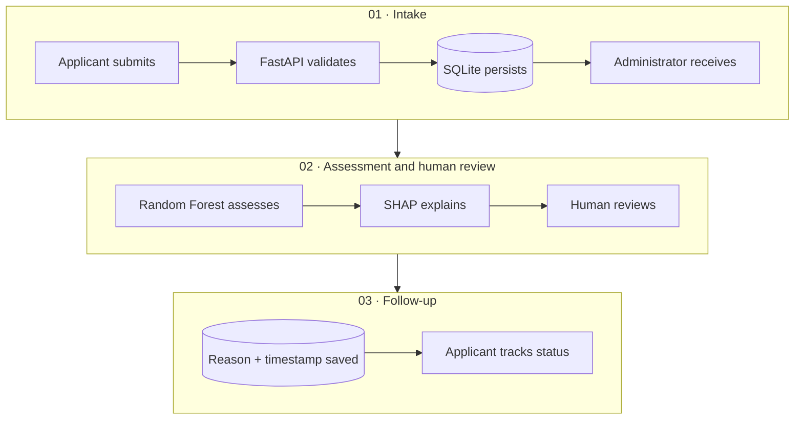

Three applicant items—**Apply for Housing**, **My Applications**, **Help & Transparency**—connect to five administrator tabs: **Overview**, **Applications**, **AI Assessment**, **Fairness & Sandbox**, **Human Review**. Both portals use the same API and SQLite database.

### 1. Submit and track

The applicant completes structured declarations, receives a reference and sees requests or completion in My Applications. No personal documents are uploaded. A stable retry key prevents repeated or concurrent submissions from creating duplicate records; the pending payload/key survives reload until success. Anonymous session IDs group records; they are **not authentication**.

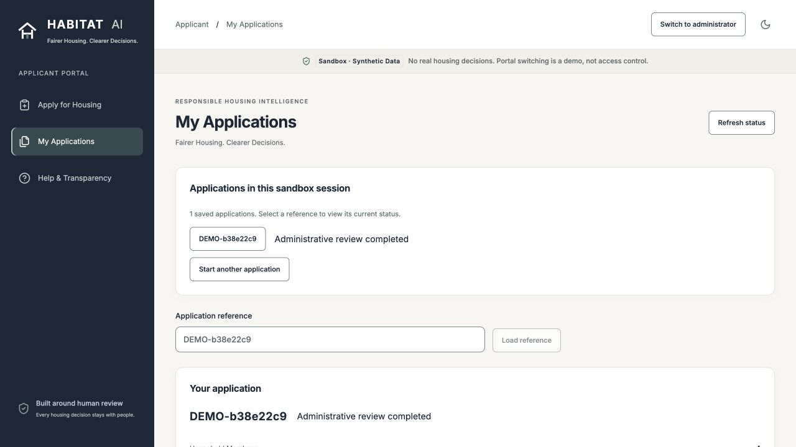

### 2. Assess and explain

The administrator explicitly runs the saved model. The screenshot shows genuine inference and Tree SHAP for `DEMO-b38e22c9`: **46.1% model-estimated additional-review probability**, separately declared **80% intake information completeness**, and **66.7% document completeness**. These describe one sandbox case, not benchmark results.

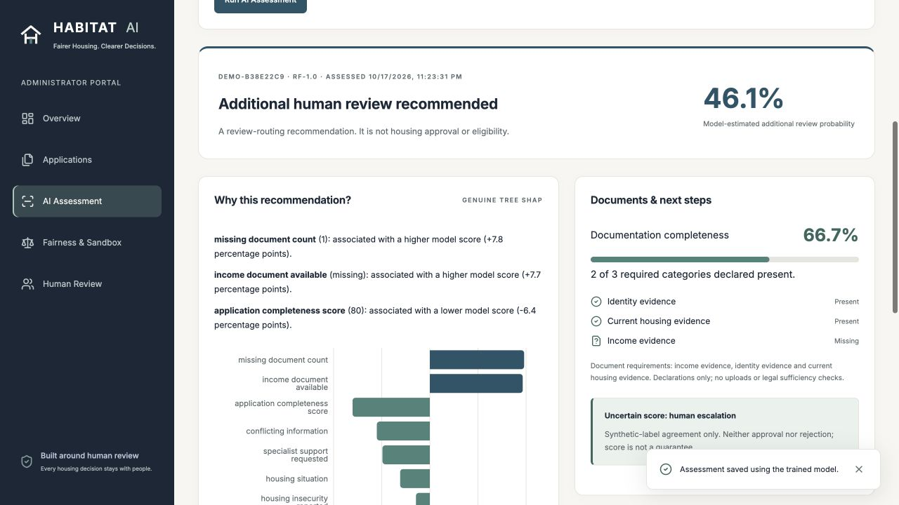

**SHAP explains model behaviour, not causality or legal reasons.** The measured base value plus feature contributions reconciles to the actual probability. An explanation failure displays an unavailable state; it does not substitute a decorative chart.

### 3. Inspect fairness and keep people in control

The audit screen exposes measured group errors, case mix and the limits of paired comparisons.

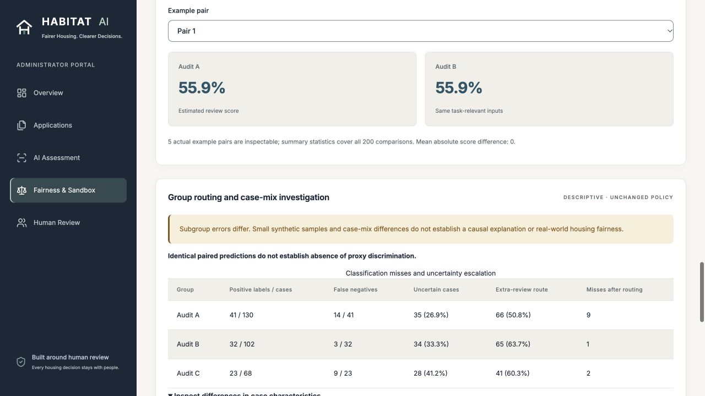

A human can challenge the recommendation, request evidence, continue review, escalate or complete the administrative review. Reasons and timestamps persist. The following is the actual history of the same demonstration case, captured from the running V7 application; completion never allocates housing.

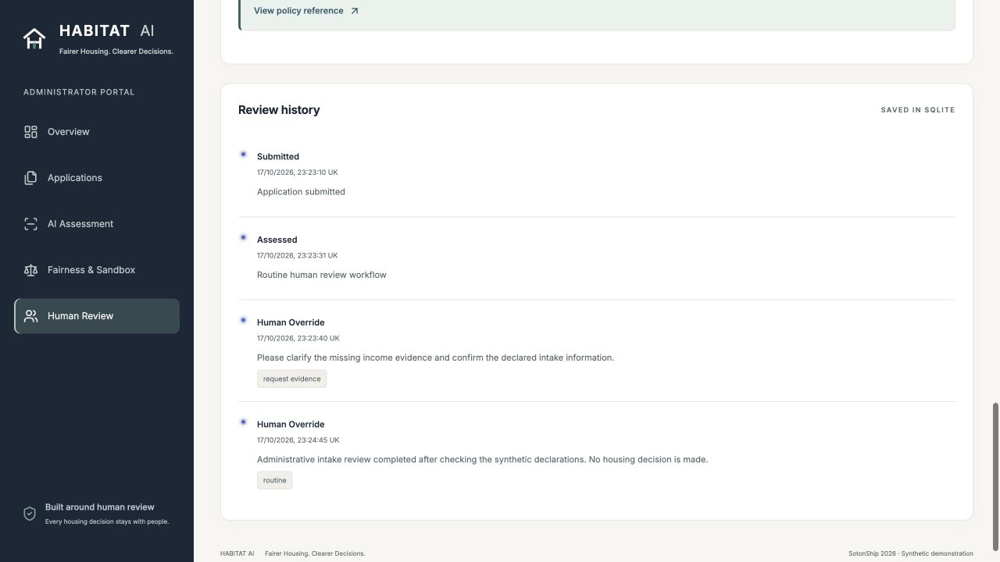

[Full click path and expected states](docs/DEMO_CHECKLIST.md) · [Browser journey, restart and failure evidence](docs/V7_FINAL_REMEDIATION_REPORT.md#actual-browser-journey-and-failure-demonstration)

## Model evidence

**Question predicted:** does this simulated intake require additional human review?

One saved scikit-learn Pipeline contains a **180-tree Random Forest**, maximum depth **8**, minimum leaf size **8**, balanced class weights and seed **42**. Preprocessing fits training data only. Nine allowed features exclude identifiers, audit group, income, accessibility-request fields and the target. The score is `predict_proba`, not a calibrated approval chance. [Model card](docs/MODEL_CARD.md) · [Training source](ml/train.py).

### Benchmark against a transparent checklist

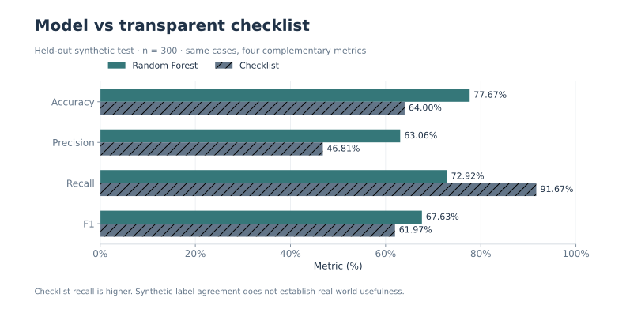

**300 held-out synthetic cases; 96 positive, 204 negative.** All four metrics are shown. The checklist has higher recall; the model does not dominate it. The checklist flags missing evidence, conflict, specialist requests, completeness below 70 or unclear housing.

| Metric | Random Forest | Deterministic checklist |
|---|---:|---:|
| Accuracy | 77.67% | 64.00% |
| Precision | 63.06% | 46.81% |
| Recall | 72.92% | **91.67%** |
| F1 | 67.63% | 61.97% |
| False-positive rate | 20.10% | 49.02% |
| False-negative rate | 27.08% | 8.33% |
| Additional-review classification rate | 37.00% | 62.67% |

Model ROC-AUC: **0.8193**. Sources: [saved comparison](reports/model_comparison.json), [evaluation](reports/evaluation.json). Synthetic-label agreement partly reflects assumptions encoded by the generator. It does not establish real-world usefulness, calibrated probabilities or housing-policy validity.

### Every classification error remains visible

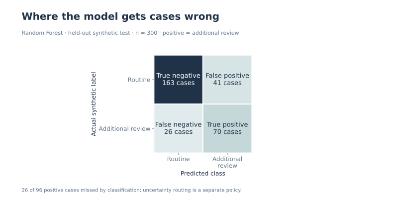

Rows are actual synthetic labels; columns are predicted classes. **26 of 96 positive cases are missed by classification**. Human uncertainty routing is a separate safeguard, described below. Source: [evaluation.json](reports/evaluation.json), **n = 300**.

## Responsible AI

**People remain responsible for every housing decision.** The prototype makes model evidence and its limits inspectable.

| Safeguard | What actually happens | What it cannot establish |
|---|---|---|
| Fairlearn group audit | MetricFrame compares held-out labels and predictions across arbitrary synthetic audit groups | Real-world fairness or causal discrimination |
| Tree SHAP | Real model contributions reconcile to the predicted score | Causality, legal justification or correctness |
| Human review and challenge | Reasoned requests, overrides, escalation and completion append to review history | Verified reviewer identity or administrator-proof logging |
| Uncertainty escalation | The retained margin sends additional cases to human review | Elimination of missed positives or a free workload reduction |
| Separate completeness measures | Document percentage comes from three declarations; intake information completeness is a distinct model input | Legal evidence sufficiency or a validated real-world measurement protocol |
| Training-range checks | Out-of-range, unseen-category or imputed inputs require human handling | Detection of every distribution shift or novel combination |
| Synthetic provenance | Seeded generator, isolated splits and separate paired tests are public | Evidence about actual housing applicants or policy outcomes |
| Explicit unavailable states | Missing model/explanation produces a visible human fallback | Production resilience or a full security guarantee |

### Measured safeguard, measured workload

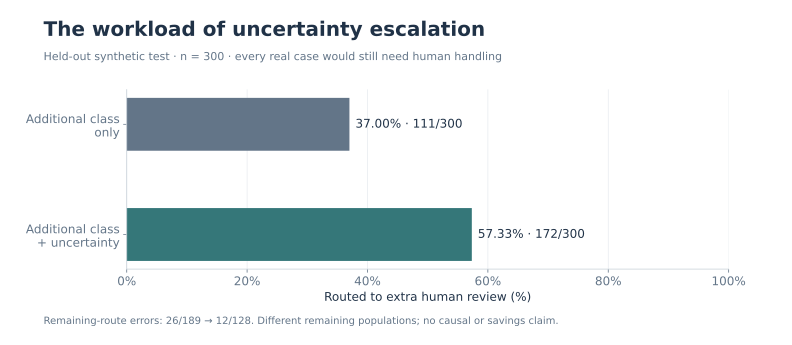

Under the unchanged original policy, uncertainty routing raises extra-review workload from **37.00% to 57.33%** on the held-out test. Errors among remaining routine-route cases change from **26/189 (13.76%)** to **12/128 (9.375%)**. These are different remaining populations, not a causal estimate or observed service saving. Every real case still needs human handling. New live input-range checks are not included in this benchmark. Source: [safeguard report](reports/v5-safeguard.json), **n = 300**.

### The 90% validation target is still unmet

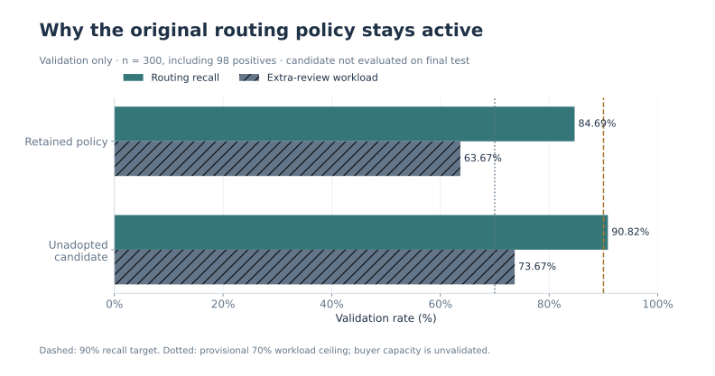

The retained policy reaches **84.69% routing recall**, below its **90%** target. Validation-only investigation found a candidate reaching **90.82%**, but it routes **73.67%** of cases to extra review, above a **provisional 70% workload ceiling** declared before exploration. That ceiling is an unvalidated operating assumption, not a buyer requirement. No monotone score cutoff met both constraints, so the original policy was retained. The candidate was **not evaluated on final test**, and no model was retrained. Source: [frozen validation investigation](reports/v7-validation-policy-investigation.json), **300 validation cases / 98 positives**.

### Fairness findings, including uncomfortable ones

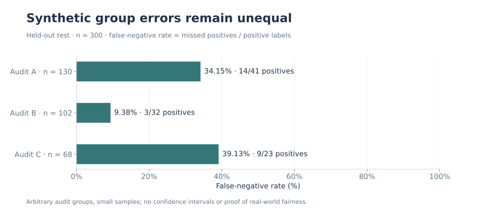

The held-out false-negative rates are **34.15% (14/41 positives)** for Audit A, **9.38% (3/32)** for B and **39.13% (9/23)** for C. Total group sizes are **130 / 102 / 68**. The max–min gap is **29.76 percentage points**. Samples are small; no confidence intervals or causal explanation are claimed. Source: [Fairlearn report](reports/fairness.json), **n = 300**; [descriptive case-mix investigation](reports/v7-fairness-input-investigation.json).

The separate **200-pair / 400-row** test changes only an excluded synthetic audit attribute: all paired scores and classes are identical, as expected by construction. **Identical paired predictions do not establish absence of proxy discrimination.** Low pairwise proxy correlation also cannot exclude nonlinear or combined proxies. The interactive comparison distinguishes excluded-attribute testing from sensitivity to genuine model inputs.

### Sandbox boundaries

Only structured synthetic declarations belong here: no names, addresses, government IDs, personal documents or government submissions. Portal switching and reference loading are demo conveniences. **No production authentication, RBAC, tenant isolation or verified reviewer identity exists. Keep services on loopback; never expose this sandbox publicly.** Local host/CORS checks and file permissions are bounded safeguards.

Production housing use, expert-labelled validation, calibrated probabilities, real-world fairness, physical touch devices, screen readers and Safari/Firefox remain untested or unestablished. [Full PASS / FAIL / NOT TESTED report](docs/V7_FINAL_REMEDIATION_REPORT.md).

## Architecture and stack

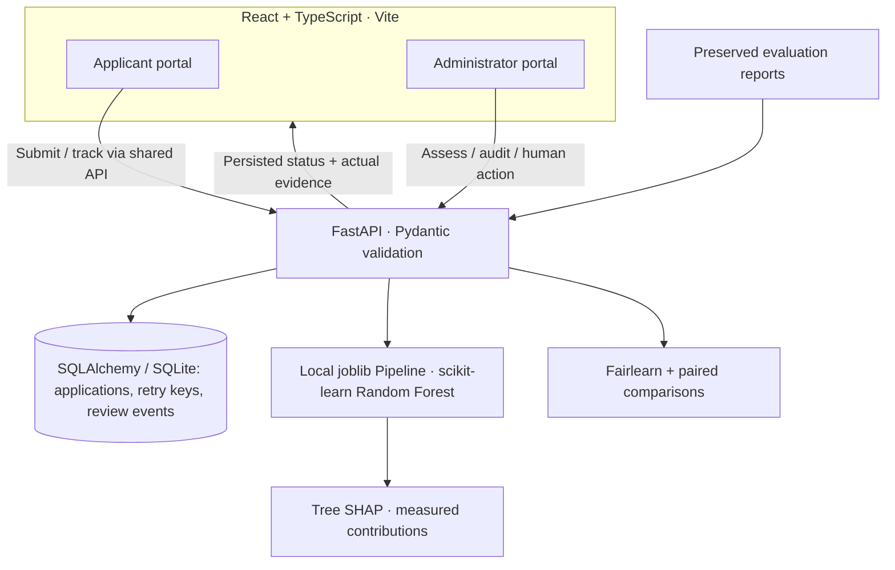

| Layer | Actual stack and purpose |
|---|---|
| Interface | React 19, TypeScript, Vite, Tailwind/CSS tokens, Lucide and lazy Recharts |
| API and persistence | FastAPI, Pydantic, SQLite / SQLAlchemy |
| Inference and explanation | scikit-learn Random Forest, joblib, SHAP |
| Fairness | Fairlearn, pandas and NumPy |
| Verification | pytest, ESLint, TypeScript, Playwright / axe and GitHub Actions |

**No LLM inference API is required.** The backend loads the included local model artifact; startup never trains it. Applicant and administrator actions share one backend. Review actions, reasons, timestamps and model versions persist in SQLite. SHAP explains that same forest. Dependency versions are pinned in the [Python lock](requirements-lock.txt) and [npm lock](frontend/package-lock.json).

## Dataset and reproducibility

This is **original generated synthetic test data published openly on GitHub**, not historical housing records. A seeded fictional intake protocol generates noisy review labels from evidence and context. Related scenario variants stay in the same partition; train/validation/test application and scenario intersections are empty. Preprocessing fits training only.

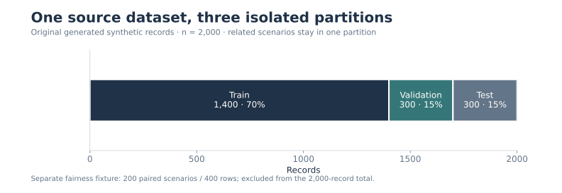

| Dataset | Records | Inspectable source |
|---|---:|---|
| Public source | **2,000** | [Synthetic CSV](data/public/habitat_synthetic_2000.csv) |
| Training | 1,400 | [train.csv](data/splits/train.csv) |
| Validation | 300 | [validation.csv](data/splits/validation.csv) |
| Held-out test | 300 | [test.csv](data/splits/test.csv) |
| Separate fairness fixture | 200 paired scenarios / 400 rows | [counterfactual_400.csv](data/public/counterfactual_400.csv) |

The paired fixture is excluded from training and selection and is **not added to the 2,000-record total**. Sources: [split metadata](reports/splits.json), [generator](data/generate_dataset.py), [dataset card](data/DATASET_CARD.md), [22-column dictionary](data/DATA_DICTIONARY.md), [model card](docs/MODEL_CARD.md).

The original model, data splits and canonical evaluation reports remain byte-identical. [Protected hashes](reports/v7-protected-artifacts.json). README figures are generated read-only from saved reports: [chart script](docs/charts/generate.py) · [exact plotted values and source hashes](docs/charts/sources.json). No application, dataset, API, SHAP implementation or model is changed by this showcase.

## Quick start for Mac

### 1. Check prerequisites and clone

Use **Python 3.12** and **Node 22.12+**. V7 verification used Python 3.12.14 and Node 22.14.0. Install missing tools from [Python](https://www.python.org/downloads/macos/) and [Node.js](https://nodejs.org/en/download), then open Terminal.

```bash
python3.12 --version
node --version
npm --version
git clone https://github.com/Advaith-Ganesh/HABITAT.git
cd HABITAT
```

Already have the repository? Open its root directory instead of cloning again.

### 2. Install pinned dependencies and build

```bash
python3.12 -m venv .venv
.venv/bin/python -m pip install -r requirements-lock.txt
cd frontend
npm ci
npm run build
cd ..
```

The scripts call the repository’s virtual environment directly; activation is optional. The trained model and evaluation reports are included.

### 3. Start the backend — Terminal 1

Run from the repository root:

```bash
bash scripts/start_backend.sh
```

### 4. Start the frontend — Terminal 2

Open a second terminal in the same repository root:

```bash
bash scripts/start_frontend.sh
```

Open [HABITAT AI locally](http://127.0.0.1:5173), [API docs](http://127.0.0.1:8000/docs) or [health](http://127.0.0.1:8000/health). Vite proxies API calls to port 8000; after building, FastAPI also serves the frontend at [port 8000](http://127.0.0.1:8000/). These are local addresses, not a deployed product.

The default database is `.test-runtime/sandbox.db`. An empty sandbox receives **12 hand-authored UI scenarios**, independent of benchmark and paired rows and without outcome labels. The historical `habitat.db` is preserved. To use a separate database, set `HABITAT_DATABASE_URL` before starting the backend; see [.env.example](.env.example). There is no automatic dotenv loading.

### Troubleshooting

| Symptom | Check |
|---|---|
| `python3.12` not found | Install Python 3.12, reopen Terminal and check `python3.12 --version`; do not silently substitute another version |
| `node` or `npm` not found / version too old | Install a supported Node release (22.12+), reopen Terminal and recheck both commands |
| Missing Python module / `.venv` missing | From the repository root, repeat step 2’s virtual-environment and pinned pip installation |
| Missing frontend dependencies | Run `npm ci` inside `frontend`, then `npm run build` |
| Port already in use | Inspect with `lsof -nP -iTCP:8000 -sTCP:LISTEN` or port `5173`; stop your earlier instance with Ctrl-C in its terminal |
| Backend service unavailable | Keep Terminal 1 running, inspect its error, check the local health URL, then use the application’s Retry / Refresh control |
| Browser storage cleared | Keep application references; use Load reference. Lost pending retry keys may prevent reload recovery—inspect status before submitting again |

For a backed-up reset of **only the default sandbox**, stop the backend first and follow the [reset instructions](docs/V7_FINAL_REMEDIATION_REPORT.md#database-reset-and-local-security-boundary). Do not delete the historical database or regenerate evaluation files for normal startup.

### Verification commands

```bash
MPLCONFIGDIR=/tmp/habitat-matplotlib .venv/bin/python -m pytest -q
.venv/bin/python -m scripts.contrast_v7
MPLCONFIGDIR=/tmp/habitat-matplotlib .venv/bin/python docs/charts/generate.py
.venv/bin/python docs/validate_showcase.py
cd frontend
npm run lint
npm run typecheck
npm run build
npm run browser:install
npm run test:e2e
```

Playwright uses managed, version-matched Chromium. Linux CI installs OS dependencies with `npm run browser:install -- --with-deps`. Browser tests use a fresh disposable database.

| Verified V7 evidence | Result |
|---|---|
| Python suite | **111 passed** |
| ESLint, TypeScript, production build | **PASS** |
| Linux Playwright | **9 passed; 0 failed, 0 skipped** |
| Responsive / accessibility checks | **375 / 768 / 1280** Chromium form, navigation and axe checks; 22 sampled contrast checks |
| Restricted local macOS standalone Chromium | **FAIL:** OS Mach-port registration denied before UI assertions; genuine in-app browser journey separately verified |

[Successful final-source CI](https://github.com/Advaith-Ganesh/HABITAT/actions/runs/39076409671) · [Machine-readable evidence](reports/v7-ci-final-evidence.json) · [Scope and limitations](docs/V7_FINAL_REMEDIATION_REPORT.md). These are identified V7 results, not a claim that every platform or every future commit passes. Automated axe checks do not certify full WCAG conformance.

## Business case: a pilot hypothesis

**Problem:** caseworkers need to inspect incomplete intake evidence, explain the next step and keep an accountable history. **Potential buyer:** a local authority or housing association. No customer traction, sales, testimonials or measured savings are claimed.

| Hypothesis | What would need validation |
|---|---|
| Four-week supervised shadow pilot | Begin with synthetic scenarios; use governed expert-labelled records only after privacy, security and domain approval. Compare missed-review cases, checklist agreement, handling time and subgroup errors. Model routing must not change housing decisions |
| £299/month starter; £999/month institutional | Willingness to pay, procurement, operating costs and support burden; these are proposed prices, not revenue |
| Illustrative **£11.23 per case**, including human handling | 1,000 cases/month; 20 routine minutes for every case + 10 extra minutes for an assumed 60%; £25/hour, £100 infrastructure and £299 software. No measured savings |
| Second customer | Review local intake definitions and evidence configuration, implement tenant/auth/RBAC boundaries, validate completeness measurement and independently test local data and fairness |

Cost arithmetic: `(1,000 × (20 + 10 × 0.60) / 60 × £25 + £100 + £299) / 1,000 = £11.23` rounded. The assumed 60% workload is a scenario, not the measured 57.33% test rate or the provisional 70% ceiling. Agree actual capacity with a buyer before selecting a replacement policy.

Only an England reference with fictional intake prompts is functional; other country metadata are future integrations. Local rollout requires verified programme definitions and domain review. [Pitch and judging evidence](docs/PITCH_V7.md) · [Policy-pack schema](policy_packs/schema.json).

## Meet the Team

HABITAT AI was created by **Advaith Ganesh, Abdul Malik and Ishaant Verma**.

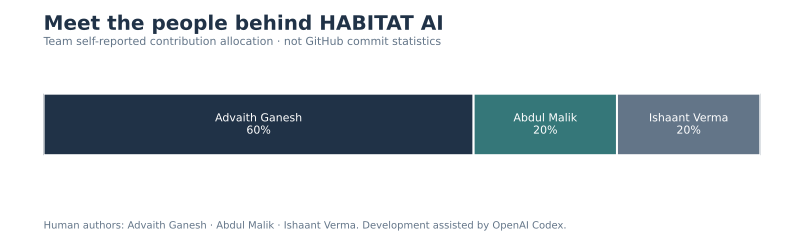

| Creator | Credit | Self-reported contribution |
|---|---|---:|
| **ADVAITH GANESH** | **Project Lead** — project direction, product architecture and full-stack integration; responsibility description supplied by the team, subject to its confirmation | **60%** |
| **ABDUL MALIK** | Team Contributor | **20%** |
| **ISHAANT VERMA** | Team Contributor | **20%** |

These percentages are the **team’s self-reported contribution allocation**, not GitHub commit statistics or an independently audited measure. No detailed roles are attributed to Abdul Malik or Ishaant Verma. Historical commit authorship and Git author settings are unchanged.

### AI-assisted development disclosure

Developed by Advaith Ganesh, Abdul Malik and Ishaant Verma with AI-assisted development using OpenAI Codex. Codex supported implementation, testing, debugging and documentation. The team directed development and is responsible for the submitted project, evaluation evidence and limitations.

### Demonstration

[Follow the actual two-minute demonstration](docs/DEMO_CHECKLIST.md). Video demonstration: not yet supplied.

## Sources and licences

Implementation evidence: [model card](docs/MODEL_CARD.md), [dataset card](data/DATASET_CARD.md), saved reports and source. Method references: [RandomForestClassifier](https://scikit-learn.org/stable/modules/generated/sklearn.ensemble.RandomForestClassifier.html), [TreeExplainer](https://shap.readthedocs.io/en/latest/generated/shap.TreeExplainer.html), [MetricFrame](https://fairlearn.org/main/api_reference/generated/fairlearn.metrics.MetricFrame.html). Online documentation may describe newer versions than the pinned environment.

[MIT](LICENSE) for original code, model and documentation; [CC0-1.0](data/LICENSE.md) for original generated records. Self-hosted Inter retains its [SIL OFL 1.1 licence](docs/third_party/Inter-OFL.txt). Original HABITAT SVG branding is retained. Dependencies and external guidance retain their respective licences.
