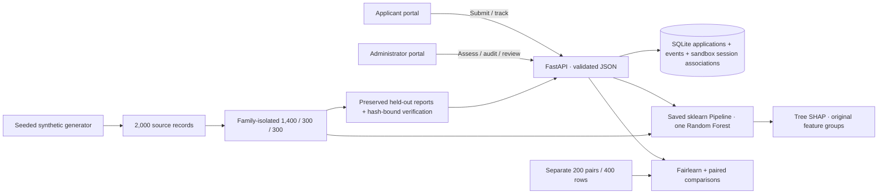
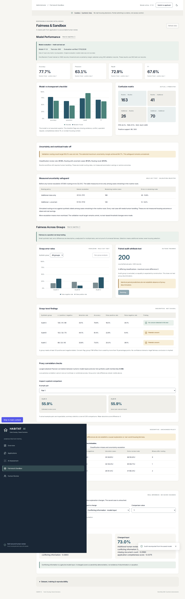

<div align="center">
  

# HABITAT AI

**Housing Application Bias, Integrity, Transparency & Accountability Toolkit.**

### Fairer Housing. Clearer Decisions.

Help housing intake caseworkers route unclear applications to human review, inspect model reasoning and keep applicants informed.

 [](LICENSE)

[Quick start](#quick-start) · [Product](#two-portals-one-accountable-workflow) · [Evidence](#the-model-and-its-actual-results) · [Demo](docs/DEMO_CHECKLIST.md) · [V7 remediation report](docs/V7_FINAL_REMEDIATION_REPORT.md)
</div>


> **Sandbox · Synthetic Data.** This project recommends human intake-review routes. It never approves housing, ranks applicant worthiness or determines statutory eligibility. The dataset is generated by this project, not observed government cases.

## Product at a glance

- Three applicant links and five administrator tabs share one SQLite database.
- Explicit saved-model inference, real SHAP, Fairlearn diagnostics and reasoned human actions.
- Held-out accuracy **77.7%**, recall **72.9%**, ROC-AUC **0.819**; the checklist has higher recall (**91.7%**).
- Active validation routing recall remains **84.7%**, below the **90%** target. Subgroup disparities remain visible.
- [Two-minute demonstration](docs/DEMO_CHECKLIST.md) · [Judging evidence](docs/PITCH_V7.md) · [Full audit](docs/V7_FINAL_REMEDIATION_REPORT.md)



## Why this exists

Incomplete evidence and unclear submissions create work for caseworkers. A model score alone cannot explain what is missing, justify a legal decision or make an accountable next step. HABITAT AI keeps document declarations, model reasoning, fairness diagnostics and caseworker actions distinct—and lets an applicant see the actual review status.

The primary workflow is housing-register intake review. The [Local Government and Social Care Ombudsman’s housing-applications fact sheet](https://www.lgo.org.uk/make-a-complaint/fact-sheets/housing/housing-applications) documents application-handling and delay complaints. Related [English homelessness assessment guidance](https://www.gov.uk/guidance/homelessness-code-of-guidance-for-local-authorities/chapter-11-assessments-and-personalised-plans) illustrates the need to assess individual circumstances and review changed information; homelessness assistance and housing allocation are distinct processes. These sources motivate accountable handling, not this synthetic model’s validity or any claim that it reduces delays.

The intended users are applicants and caseworkers; proposed buyers are subsidised-housing administrators, housing authorities and relevant NGOs. This is a university hackathon prototype for **SotonShip 2026 Responsible AI**, not an operational public service.

## Two portals, one accountable workflow

| Applicant portal — three items | Administrator portal — exactly five tabs |
|---|---|
| **Apply for Housing:** guided household, income, housing, evidence and support declarations | **Overview:** persisted counts and recent case activity |
| **My Applications:** server-backed session list, saved references, document status and caseworker requests | **Applications:** searchable, filtered, paginated records and details |
| **Help & Transparency:** plain-language model, privacy and sandbox explanation | **AI Assessment:** explicit inference, genuine SHAP and the next human step |
| Anonymous sandbox session; no account or file upload | **Fairness & Sandbox:** model performance, group errors and paired comparisons |
| Applicant views contain no internal fairness dashboard or review controls | **Human Review:** mandatory-reason actions and timestamped history |

**The working journey:** submit → receive a reference → administrator finds the unassessed case → run the saved model → inspect SHAP and missing evidence → request information, escalate or complete administrative review → applicant sees the persisted status.

Submitted payloads, assessment/version/timestamp, review outcomes and the application-to-session index are all stored in SQLite. The browser retains an anonymous UUID grouping key, the selected reference and optional drafts. `POST /api/applications` requires every structured intake field; omission or invalid values returns 422 without saving a record. The `X-Sandbox-Session` header groups submissions; it is **not authentication**. Keep references if browser storage is cleared. Older saved references can still be opened through **Load reference**.

A submission uses a stable UUID retry key: database lookup and insert are one serialized SQLite transaction. A repeated key/payload returns the same reference, and changed data under that key returns 409. The browser retains an unconfirmed payload/key until success, including across reload.

A successful mutation refetches the affected state. A storage event notifies other same-origin demo tabs; returning to a visible tab also refreshes it. There is no fixed-interval polling. Refresh controls remain available if browser storage events are unavailable.

The V7 browser journey used real reference `DEMO-b38e22c9`: 46.1% model-estimated extra-review probability, separately declared 80% information completeness and calculated 66.7% document completeness. Caseworker request/completion, a full backend restart and a repeated request were verified. These are observed sandbox examples, not benchmark metrics or fixed product counts. [Evidence and limitations](docs/V7_FINAL_REMEDIATION_REPORT.md).

### A clear distinction: documents versus model output

Documentation completeness is **present declarations / required categories × 100**. The demo protocol requires income, identity and current-housing evidence. Two declared present categories give **2/3 = 66.7%**; the missing category is named from saved flags. It is not an eligibility score or a statutory document checklist.

The separate **“Model-estimated additional review probability”** is real `predict_proba` output. It is neither a housing approval chance nor calibrated certainty. V7 separately collects the existing model's **intake information completeness** input. Training gives that feature independent synthetic noise; mapping it to four document percentages was a V6 mismatch. The new field makes the distinction explicit, but a real-world caseworker measurement protocol remains unvalidated. Out-of-training numeric ranges, unseen housing categories and imputed inputs now require human handling; range checks cannot detect every distribution shift.


## Implementation

| Layer | Implementation |
|---|---|
| Frontend | React 19, TypeScript, Vite, Tailwind/CSS tokens, Lucide, lazy Recharts |
| API and persistence | FastAPI 0.115.12, Pydantic 2.11.4, SQLAlchemy 2.0.40, SQLite |
| Model and audit | scikit-learn 1.6.1, SHAP 0.47.2, Fairlearn 0.12.0, pandas/NumPy, joblib |
| Verification | pytest, HTTP integration checks, TypeScript, ESLint, Playwright and real in-app browser automation |
| Branding | Original SVG assets, self-hosted Inter, warm off-white/ink/petrol/sage themes |

Exact dependencies: [Python lock](requirements-lock.txt), [frontend lock](frontend/package-lock.json). No GPT API, chatbot, paid inference service or second trained model.

## Public data, with explicit provenance

[**Download the public 2,000-record synthetic CSV**](data/public/habitat_synthetic_2000.csv) · [Dataset card](data/DATASET_CARD.md) · [22-column dictionary](data/DATA_DICTIONARY.md) · [Generator](data/generate_dataset.py)

| Partition | Records | Scenario families | Share |
|---|---:|---:|---:|
| Training | 1,400 | 700 | 70% |
| Validation | 300 | 150 | 15% |
| Final test | 300 | 150 | 15% |
| **Source total** | **2,000** | **1,000** | **100%** |

NumPy seed 42 generates paired intake variants within each simulated household. A probabilistic fictional intake protocol combines missing evidence, conflicting information, specialist-review need, housing context and completeness with simulated noise. Neither income nor real-world eligibility thresholds define the label. Related variants remain in one partition; application/scenario intersections are checked to be empty. Preprocessing fits training only. Full regeneration of the source CSV is byte-reproducible with pinned dependencies.

**Separate fairness fixture:** [200 scenarios / 400 rows](data/public/counterfactual_400.csv), generated with seed 4242, excluded from training/selection and screened for exact model-input duplicates of source records. Each pair changes only an arbitrary synthetic audit-group label. These 400 rows are not an extra training partition or part of the 2,000-record count.

## The model and its actual results

Target: **does this simulated intake require additional human review?**

One saved RandomForestClassifier: **180 trees**, maximum depth **8**, minimum leaf **8**, balanced weights, seed **42**. The Pipeline performs train-only median numeric imputation and categorical imputation/one-hot encoding. Nine permitted inference features exclude target, identifiers, audit group, income and accessibility-request fields. [Training code](ml/train.py) · [Model card](docs/MODEL_CARD.md).

Architecture is fixed; threshold ≈0.50 is selected using validation F1. The uncertainty margin 0.16 is validation-selected. **No V7 retraining or test-set tuning occurred. All ten canonical evaluation inputs remain byte-identical.**

**Model evaluation — held-out test set**, model `rf-1.0`, **300 records**. Recomputed on 17 October 2026; exact timestamp and artifact hashes are in [verification metadata](reports/evaluation_verification.json). This is the recomputation date, not an invented historical training timestamp.

| Metric | Random Forest | Deterministic intake checklist |
|---|---:|---:|
| Accuracy | 77.67% | 64.00% |
| Precision | 63.06% | 46.81% |
| Recall | 72.92% | **91.67%** |
| F1 | 67.63% | 61.97% |
| False-positive rate | 20.10% | 49.02% |
| False-negative rate | 27.08% | 8.33% |
| Additional-review classification rate | 37.00% | 62.67% |

Confusion matrix, rows actual/columns predicted: **[[163,41],[26,70]]**. Positive support 96; negative support 204; ROC-AUC **0.8193**. The checklist flags missing evidence, conflict, specialist request, completeness below 70 or unclear housing. **It has higher recall. The model does not dominate it.** [Evaluation](reports/evaluation.json) · [Baseline comparison](reports/model_comparison.json) · [Read-only recomputation](reports/v7-ml-audit.json).

Synthetic-label agreement is partly circular: generator assumptions appear in both inputs and labels. These results do not prove real-world predictive usefulness, calibrated probabilities or housing-policy validity.

### Individual explanations

Tree SHAP runs against the saved forest. Encoded categorical contributions aggregate back to original feature groups; numeric contributions retain input identity. The base value plus all contributions is checked against the actual positive-class probability. Plain-language summaries use the measured signs and values; petrol/sage bars show opposite influence directions.

Attributions describe the model, not causes or legal evidence. Correlated evidence fields can divide attribution in unstable ways. A SHAP error produces an explicit unavailable state; it never substitutes a decorative chart. Human review remains available. [Explanation implementation](ml/explain.py).

## Fairness, without a perfect-score claim

Inside **Fairness & Sandbox**, three sections keep the audit readable: **Model Performance**, **Fairness Across Groups**, **Compare Two Applications**. Short expandable explanations describe each test.

Fairlearn MetricFrame receives actual held-out labels, thresholded predictions and the separate synthetic audit attribute. “Selection” means additional intake review, never allocation.

| Arbitrary synthetic group | n | Positive / negative labels | FPR | FNR |
|---|---:|---:|---:|---:|
| Audit A | 130 | 41 / 89 | 17.98% | 34.15% |
| Audit B | 102 | 32 / 70 | 22.86% | 9.38% |
| Audit C | 68 | 23 / 45 | 20.00% | 39.13% |

Observed max–min FNR gap: **29.76 percentage points**. Two groups trigger the documented concern heuristic; a group needs at least 20 positive and 20 negative labels, otherwise the result is inconclusive. The heuristic flags an FNR difference from the overall rate above 10 percentage points. No confidence intervals, multiple-testing adjustment, causal discrimination finding or mitigation improvement is claimed.

The separate **200-pair test** reports **zero class differences and zero mean/max score difference** when changing only the excluded audit group. Equality is expected by construction; it does not establish absence of proxy bias. Largest measured absolute numeric-input/group-membership Pearson correlation: about **0.148**. [Saved Fairlearn/paired results](reports/fairness.json).

The interactive comparison runs actual inference and SHAP twice without changing the saved case. Changing a genuine model input is clearly labelled sensitivity, not discrimination evidence.



### Uncertainty escalation: measured cost of a safeguard

The desired **90% validation routing recall was missed: 84.69%**. The UI keeps this warning visible.

| Policy on untouched test data | Human escalation | Remaining routine-route cases | Errors among remaining cases |
|---|---:|---:|---:|
| Before any escalation | 0% | 300 | 67/300 = 22.33% |
| Additional class only | 111/300 = 37.00% | 189 | 26/189 = 13.76% |
| Additional + uncertainty | 172/300 = 57.33% | 128 | 12/128 = 9.375% |

Adding uncertainty escalation increases human workload **20.33pp** and lowers remaining-route error **4.38pp** relative to additional-class-only routing. These are different remaining populations. This is descriptive synthetic routing performance, not a causal intervention estimate, real housing outcomes or measured savings. Even routine cases still need human handling. [Full safeguard results](reports/v5-safeguard.json).

## Human oversight, privacy and sandbox boundaries

- Requests for information, continued additional review and specialist escalation remain queued. Completion resolves only the administrative review.
- Reassessment updates the model result while preserving an open caseworker follow-up. Reasons and timestamps append to SQLite; completed reviews cannot be silently reopened by inference.
- Missing inputs/artifacts produce a no-score human fallback. Strict request schemas reject extra fields, inconsistent declarations and non-synthetic submissions.
- Only structured synthetic declarations: no names, addresses, government IDs, personal document uploads or government submissions.
- Portal switching and reference loading are **demo conveniences, not security**. Production requires authentication, RBAC, tenant isolation, verified reviewer identity and privacy governance.
- API no-store, fixed-path downloads and security headers are bounded safeguards. SQLite triggers are not administrator-proof; a synthetic-data declaration cannot detect every misuse.

## Quick start

Verified runtime: **Python 3.12.14**, **Node 22.14.0**; use Python 3.12 and Node ≥22.12 for closest reproduction. From the repository root:

```bash
python3.12 -m venv .venv
.venv/bin/python -m pip install -r requirements-lock.txt
cd frontend
npm ci
npm run build
cd ..
```

The repository includes the trained model and measured reports. **Normal startup does not train anything.**

**Terminal 1 — backend**

```bash
bash scripts/start_backend.sh
```

**Terminal 2 — frontend**

```bash
bash scripts/start_frontend.sh
```

Open [the application](http://127.0.0.1:5173), [interactive API docs](http://127.0.0.1:8000/docs) or [OpenAPI JSON](http://127.0.0.1:8000/openapi.json). Vite proxies API calls to port 8000. After building, FastAPI also serves the built frontend at [port 8000](http://127.0.0.1:8000/).

SQLite now defaults to `.test-runtime/sandbox.db`, seeding 12 independent hand-authored UI scenarios only when empty. They have no outcome labels and do not duplicate any of the 2,000 benchmark or 400 paired-test feature rows. The older `habitat.db` is preserved as historical evidence and is never reset by the new utility. To isolate browser work, export a different `HABITAT_DATABASE_URL` before starting the backend. [Environment example](.env.example) documents the variable; there is no automatic dotenv loading. Keep services loopback-only.

### Restore a known sandbox state

Stop the backend first. `MPLCONFIGDIR=/tmp/habitat-matplotlib .venv/bin/python -m scripts.reset_sandbox` backs up `.test-runtime/sandbox.db` into `.test-runtime/backups/` before recreating the twelve independent UI scenarios. It never resets the historical `habitat.db`, public CSVs, model or evaluation evidence. Keep the backup if submitted sandbox records matter. There is no public reset endpoint.

### Read-only verification and tests

```bash
MPLCONFIGDIR=/tmp/habitat-matplotlib .venv/bin/python -m scripts.audit_v7
MPLCONFIGDIR=/tmp/habitat-matplotlib .venv/bin/python -m pytest -q
.venv/bin/python -m scripts.contrast_v7
.venv/bin/python -m scripts.validate_readme_v7
cd frontend
npm run lint
npm run typecheck
npm run build
npm run browser:install
npm run test:e2e
```

Playwright uses its version-matched managed Chromium, installed with `npm run browser:install`; installation and tests share one absolute project cache path. On Linux CI, `npm run browser:install -- --with-deps` also installs OS dependencies. Tests start a fresh disposable database with independent UI fixtures and never write the original workspace. [Official browser installation guidance](https://playwright.dev/docs/browsers).

**Actual V7 execution:** 111 Python tests, lint, types, production build, read-only ML audit and 22 sampled contrast checks pass. Clean Linux CI passes all 9 Playwright tests, including the 375/768/1280 form/navigation/axe matrix, with 0 skipped. This macOS execution sandbox denies Chromium's Mach-port registration, so local browser cases still fail before assertions. Linux CI successfully installs and launches the supported browser; it exposed mobile navigation and keyboard-scroll defects that were fixed. The exact final test totals and PASS / FAIL / NOT TESTED boundaries are recorded in [the V7 report](docs/V7_FINAL_REMEDIATION_REPORT.md), with linked genuine CI logs and screenshots. Automated axe checks do not constitute full accessibility certification.

### Explicit regeneration and retraining

These commands intentionally replace generated training/evaluation artifacts; make a checkpoint first. They were syntax-reviewed, **not rerun in V7**, because the preserved model required no retraining.

```bash
bash scripts/reproduce.sh
```

That script runs the generator, fits the single model, evaluates, regenerates verification metadata and executes tests. Individual stages:

```bash
.venv/bin/python -m data.generate_dataset
.venv/bin/python -m ml.train
MPLCONFIGDIR=/tmp/habitat-matplotlib .venv/bin/python -m ml.evaluate
MPLCONFIGDIR=/tmp/habitat-matplotlib .venv/bin/python -m scripts.audit_v5
```

Use the pinned environment, restart the backend after artifact changes, and update model-version/documentation when changing model design. Do not tune thresholds on the final test set.

## API surface

| Purpose | Route |
|---|---|
| Actual fitted-model/DB health | `GET /health` |
| Persisted overview | `GET /api/dashboard` |
| Submit/list/detail | `POST /api/applications`, `GET /api/applications`, `GET /api/applications/{id}` |
| Retry-safe submission | Send a stable UUID `Idempotency-Key` on `POST /api/applications`; replay returns the same reference (201), mismatched payload returns 409 |
| Applicant session list | `GET /api/applicant/applications` with `X-Sandbox-Session: <UUID>` |
| Assess / real explanation | `POST /api/applications/{id}/assess`, `GET /api/applications/{id}/explanation` |
| Queue / reasoned action | `GET /api/reviews`, `POST /api/reviews/{id}/resolve` |
| Fixed held-out evidence | `GET /api/model/metrics`, `/api/model/baseline`, `/api/model/metadata`, `/api/model/safeguard` |
| Additional descriptive audit | `GET /api/audit/investigation` — group routing, case characteristics and training-input consistency |
| Group / paired audit | `GET /api/fairness/metrics`, `POST /api/fairness/run`, `/api/fairness/counterfactual` |
| Read-only sensitivity | `POST /api/sandbox/compare` |
| Public provenance/downloads | `GET /api/dataset/metadata`, `/download`, `/card`, `/dictionary` under `/api/dataset` |
| Versioned reference packs | `GET /api/policies` |

Model metrics remain constant until their artifacts change; live application counts come from SQLite. [V7 findings and number sources](docs/V7_FINAL_REMEDIATION_REPORT.md) document the changed input mapping and measured investigations; older versioned audits remain historical evidence.

## Pilot, business model and international configuration

**B2B SaaS hypothesis:** £299/month starter; £999/month institutional. No sales, customers, revenue, sponsors or testimonials are invented. An expandable Overview summary exposes assumptions rather than adding another tab.

**Primary user:** a caseworker handling a housing-register intake queue. **Proposed paying buyer:** a local authority housing service or housing association with an intake team; no customer has been recruited or validated.

**Illustrative £11.23/case:** assume 1,000 monthly applications, 20 routine minutes for every case, another 10 minutes for an assumed 60% requiring extra review, £25/hour, £100 infrastructure and £299 software: `(1000 × (20 + 10 × 0.60)/60 × 25 + 100 + 299) / 1000`. Every case still receives human handling. These are operating hypotheses, not observed savings, actual workload or sales.

**Proposed first pilot:** four weeks of supervised shadow review, initially on synthetic scenarios and then only on appropriately governed, expert-labelled records after privacy/security and domain approval. Compare caseworker agreement, missed-review cases, handling time and subgroup errors against the transparent checklist. Do not let model routing change housing decisions. Agree the extra-review capacity ceiling with the buyer before choosing any replacement policy.

**Second-customer plan:** retain the common intake/review code, replace the local intake definitions and evidence requirements through reviewed programme configuration, implement authenticated tenant/role isolation, validate the completeness measurement, test independent customer data and rerun fairness/workload checks. No ready-made multi-country allocation system is claimed. [Two-minute pitch and judging evidence](docs/PITCH_V7.md).

[Policy-pack schema](policy_packs/schema.json) and [backend policy interface](backend/policy.py) separate programme configuration from model inference. Only an England reference with explicitly fictional intake prompts is functional. US, India and Singapore metadata remain future integrations. International rollout requires verified local programmes, legal/domain review, localisation and fresh validation; no four-country housing system is claimed.

## Known limits and submission readiness

**Ready for the tested synthetic demonstration; not for operational housing use.** Missed validation target and subgroup disparities remain unresolved. No real-world expert labels, calibrated probabilities, confidence intervals, causal fairness analysis, production auth/RBAC, reviewer identity assurance or adversarial security audit. Wider API ranges can be out of training distribution. Applicant views can track requests but cannot upload or supply personal documents. A stable UUID idempotency key protects repeated and simultaneous submissions, scoped to the anonymous sandbox session. The browser retains an unconfirmed payload/key for retry after reload; a changed payload requires a new key. Keys are stored hashed server-side. If browser storage is unavailable or cleared, refresh recovery is not guaranteed; inspect status rather than submit a new key blindly.

The original model, public datasets, splits and evaluation/fairness JSON remain byte-identical. V7 browser writes use a separate database with independent UI scenarios. The original database is preserved. [Integrity evidence](reports/v7-integrity.json) · [Submission checklist](docs/SUBMISSION_READINESS.md).

## Team, demonstration and AI disclosure

| Item | Honest status |
|---|---|
| Hackathon | SotonShip 2026 Responsible AI |
| Human team members and roles | To be supplied by the team; no names invented |
| Video demonstration | Not recorded yet—replace this line with a genuine video link |
| Live demo script | [Exact click path](docs/DEMO_CHECKLIST.md) |
| Judge preparation | [Grounded technical, ethical and commercial Q&A](docs/JUDGE_QA.md) |

Codex assisted implementation, synthetic generation, tests, training/evaluation execution and documentation. Runtime inference uses local sklearn, not an LLM API. Human housing-policy validation remains outstanding.

## Sources, credits and licences

Implementation evidence lives in the [model card](docs/MODEL_CARD.md), [dataset card](data/DATASET_CARD.md), source and inspectable reports. Method references: [scikit-learn RandomForestClassifier](https://scikit-learn.org/stable/modules/generated/sklearn.ensemble.RandomForestClassifier.html), [SHAP TreeExplainer](https://shap.readthedocs.io/en/latest/generated/shap.TreeExplainer.html), [Fairlearn MetricFrame](https://fairlearn.org/main/api_reference/generated/fairlearn.metrics.MetricFrame.html). Dependencies are pinned to the versions above; reference websites may document newer releases.

[English allocation guidance](https://www.gov.uk/guidance/allocation-of-accommodation-guidance-for-local-authorities) is a linked reference, not one universal local allocation scheme. Functional demo prompts are fictional and do not invent legal eligibility rules.

[MIT](LICENSE): original code, model and documentation. [CC0-1.0](data/LICENSE.md): original generated records. Self-hosted Inter retains its [SIL OFL 1.1 licence](docs/third_party/Inter-OFL.txt). Dependencies and source guidance retain their respective licences. The SVG brand assets are original project work; no proprietary design or stock testimonial is claimed.
