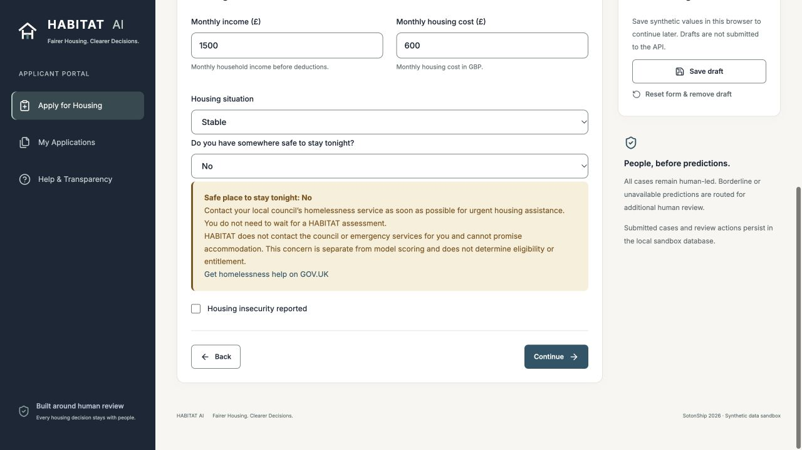
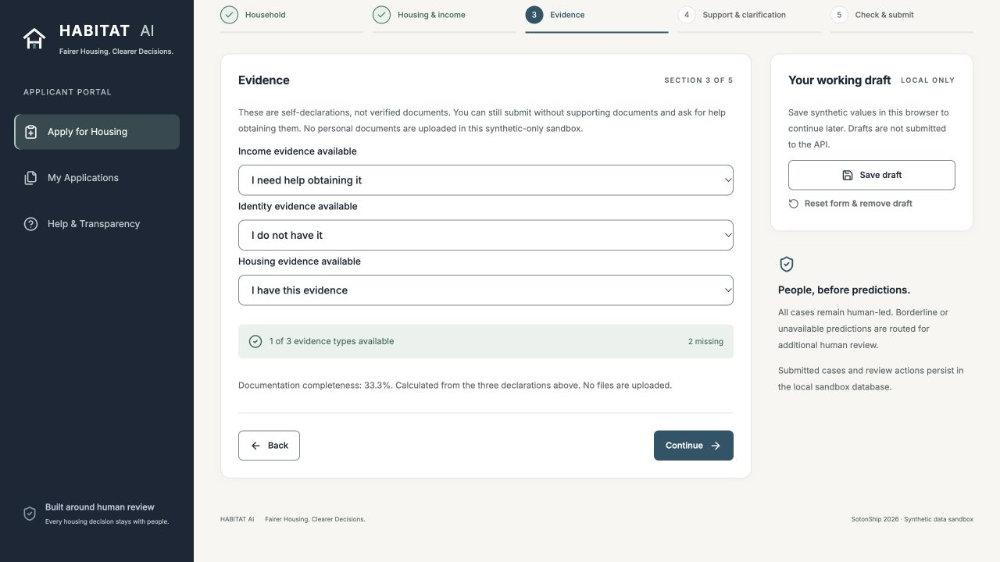
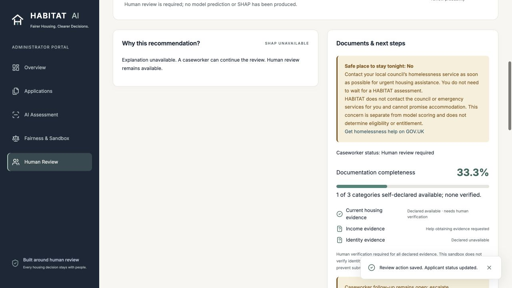

# Safeguarding and evidence UX verification

Scope: small addition on `fix/safeguarding-evidence-ux`, based on main `9751889` (merged V7.1 completeness fix, PR #2). No redesign, model retraining, dataset edits, metric replacement or database reset.

## Functional changes

- `backend/main.py`: optional `safe_to_stay_tonight` (yes/no/unsure; old records unanswered) and `evidence_help_needed` (income/identity/housing) are separate non-model metadata in SQLite payload JSON. Availability remains 1 for “I have this evidence”, 0 for unavailable/help. Invalid categories, duplicate help requests and help/availability contradictions return 422. Existing retry hashes remain compatible; changed concerns cannot silently replay an old key.
- `frontend/src/components/HousingSupport.tsx`: local, static guidance and the official GOV.UK link. No/Unsure highlights a concern independently of API health, model availability, probability or eligibility. No automated contact or promise of accommodation.
- `NewCaseForm.tsx`: required tonight question, three-way self-declarations, explicit submission without documents, no uploads. The existing five-step structure and styles remain.
- `ReviewWorkspace.tsx`: applicant and administrator see tonight declarations, help requests, unavailable evidence, human verification outstanding, review status and the existing reasoned follow-up/history controls. Percentages count three self-declared categories only; none are verified.
- `frontend/src/main.tsx`: includes metadata in drafts, submission and stable retry payloads.
- Regression coverage in `tests/test_safeguarding.py`, `tests/test_v6_integration.py`, `frontend/e2e/habitat.spec.ts`; README disclosure and genuine screenshots accompany this report.

## Completeness and scientific boundaries

V7.1 remains intact. Training-time completeness was `round(clip(100 - 18 * missing_document_count - rng.normal(8,12), 5,100),1)`. The unobserved noise cannot be recovered from declarations. New submissions store null, use human review without model prediction or SHAP, and cannot inject a trusted completeness percentage. Historical numeric-input inference and genuine SHAP remain available. Neither new metadata field belongs to the unchanged nine model features. Genuine Fairlearn/evaluation endpoints remain unchanged.

## Live requested scenario

Actual browser journey on loopback, saved as **HAB-F6324038**: household 3, no safe place tonight, no identity evidence, help obtaining income documents, housing evidence self-declared available. Guidance appeared before submission. Submission succeeded; SQLite stores the metadata, availability flags and null completeness. Administrator found the exact reference and recorded a reasoned specialist follow-up. Applicant refresh shows human review required and the saved follow-up history; this is not a housing decision.

Screenshots are actual application captures:

## Verification status

| Check | Status | Evidence |
| --- | --- | --- |
| Python suite | PASS | 127 tests; 15 dependency deprecation warnings |
| ESLint / TypeScript / production build | PASS | Local checks completed |
| Local standalone Playwright launch | FAIL (environment) | Chromium launch restricted; 3 API tests passed, 8 browser tests could not launch. Not represented as a passing browser suite. |
| Real local browser requested journey | PASS | Reference and screenshots above; genuine API/SQLite, no substituted success responses |
| Backend restart, history persistence, integrity | PASS | 156 pre-existing ML/data/report files unchanged; historical/workspace payloads and events retained. Disposable runner DB excluded. [Evidence](../reports/safeguarding-integrity-workflow.json) |
| Supported Linux Playwright / GitHub Actions | Pending | Must pass before merge |

## Limitations

This remains **Sandbox · Synthetic Data**: the original public, reproducible 2,000-record project-generated dataset and genuinely trained Random Forest are preserved. Guidance and follow-up recording are functional sandbox safeguards; actual council referrals, emergency response, document/identity verification, caseworker services, statutory eligibility, housing allocation and rejection are not implemented. No real names, addresses, identity numbers or personal-document uploads are collected. Production authentication, RBAC, verified reviewer identity and real-world validation remain absent. Existing recall/subgroup fairness limitations remain; these UX changes do not validate the model for real applicants.
