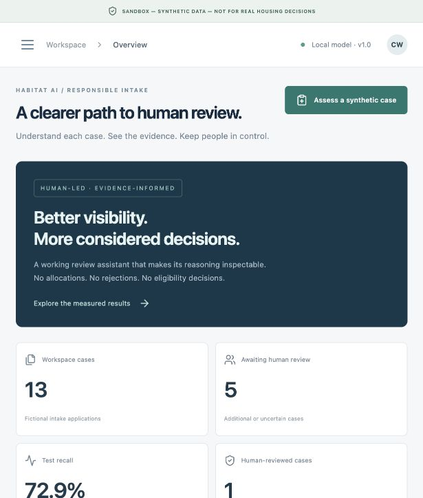
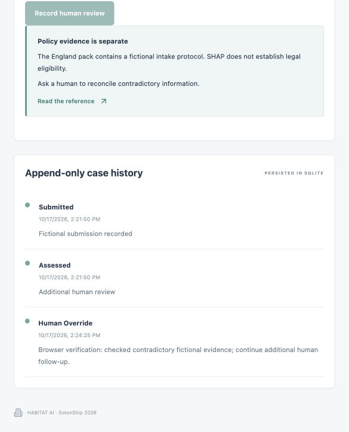

> Historical V1 verification. The final V2 results and limits are in [V2 audit](V2_AUDIT_REPORT.md) and [submission readiness](SUBMISSION_READINESS.md).

# Execution verification · 17 October 2026

Executed locally using Python 3.12.14 and Node 22.14.0. Full reports, not claimed outcomes from unexecuted tests, are included.

| Acceptance criterion | Result | Evidence |
|---|---|---|
| 1. Exactly 2,000 reproducible source records | PASS | Full CSV byte comparison in pytest; seed 42 |
| 2. Correct grouped splits | PASS | 1,400/300/300; disjoint application and scenario IDs; reports/splits.json |
| 3. Real fitted Random Forest | PASS | 180 fitted estimators; one production Pipeline |
| 4. Artifact loads | PASS | Inference and API tests load models/habitat_review_model.joblib |
| 5. Measured test evaluation saved | PASS | reports/evaluation.json, confusion_matrix.png, model_comparison.json |
| 6. Real Fairlearn evaluation | PASS, concerns found | FNR gap 29.76 percentage points; B/C concern flags |
| 7. Separate paired audit | PASS | 200 pairs, 400 rows; seed 4242; duplicate input exclusion; zero score/class differences |
| 8. Real SHAP | PASS | TreeExplainer with transformed/category aggregation; additivity error <1e-6 in tests |
| 9. Fictional submission | PASS | API tests and browser-created DEMO-67cf1fcc |
| 10. Frontend/API communication | PASS | Browser flow through Vite proxy; genuine score .7139935504559233 |
| 11. Human review persists | PASS | Reason stored in SQLite; fresh DB session test; browser reopened case |
| 12. Dataset download | PASS | API response contains 2,001 CSV lines including header |
| 13. Sandbox warnings visible | PASS | Browser screenshots and synthetic-only API validation |
| 14. No fabricated statistics | PASS | UI fetches reports; tests recompute metrics from the saved model/test data |
| 15. Backend tests | PASS | 41 passed, 15 dependency deprecation warnings; reports/pytest.txt |
| 16. Frontend production build | PASS | TypeScript + Vite; reports/frontend-build.txt |
| 17. README measured results | PASS | Metrics copied from calculated reports; baseline recall advantage disclosed |
| 18. Claims and limitations | PASS within demo scope | Dataset/model cards, policy source/assumptions, failed target and subgroup warnings |

## Browser workflow actually executed
Using the available in-app browser, at a narrow responsive viewport:
1. Opened overview and clicked Assess a synthetic case.
2. Kept fictional defaults, checked contradictory information and confirmed values were fictional.
3. Submitted DEMO-67cf1fcc; real score 71.399355%, category additional human review.
4. Inspected actual SHAP chart, prose, separate policy prompt and additivity error ~5.2e-15.
5. Opened Fairness Lab, verified group counts/rates and concern flags; reran 200 paired predictions.
6. Opened Human Review, found the submitted record, reopened it.
7. Entered a mandatory reason and recorded additional human follow-up.
8. Observed human_override in event history; reopened record and confirmed persistence through both UI and API.
9. Opened model performance and checked actual confusion matrix / model-baseline charts.

These browser actions were executed through the UI tool, not a saved CI browser script. Repeatable manual steps are in demo_script.md; repeatable API integration tests are in tests/test_api.py. Screenshots are genuine browser captures, not generated mockups. Desktop CSS is implemented; this run visually inspected the narrow in-app browser layout, not a matrix of desktop/mobile devices.

## Issues and unresolved limitations
- **Validation recall target missed:** desired 90%, achieved 84.7% at the maximum candidate margin. Test uncertainty-routing recall 87.5%; 12 positive labels remain routine. Routine cases still require human handling.
- **Fairness concerns remain:** FNR max–min gap 29.76 percentage points across arbitrary synthetic groups. No mitigation or real-world fairness claim.
- **Synthetic circularity:** the generator defines labels; no independent housing expert labels or real service validation.
- **Local sandbox security:** no auth/tenant isolation/encryption/rate limiting. Audit log protects against application-level mutation, not a malicious database administrator. Synthetic declarations cannot enforce whether typed values describe a real person.
- **Production build warning:** the main JavaScript chunk exceeds 500 kB. Build succeeds; code splitting remains an optimisation.
- **Dependency warnings:** 15 deprecation warnings from installed test/plot dependencies. No failed tests. Final npm audit reports zero vulnerabilities at execution time, which is not a complete security audit.
- **Placeholders:** US/India/Singapore policy rules are not implemented; England uses fictional intake prompts with a verified guidance link, not statutory eligibility calculations.
- **Not published:** no GitHub remote was supplied, so no repository was pushed. No live deployment or real government integration was attempted. All source, model and public data are in the deliverable folder/archive.
- **Team/video:** human team names and real demo-video link remain explicit TODOs.

## Production serving and restart persistence
The built frontend was served from FastAPI at `/` with HTTP 200. Health, metrics and the 2,000-record CSV download returned HTTP 200. After stopping and restarting the backend, DEMO-67cf1fcc remained resolved with submitted/assessed/human_override events. Vite proxy metrics also returned HTTP 200. Real results: reports/production-smoke.json. Temporary verification servers were stopped after packaging; use the README startup commands.
